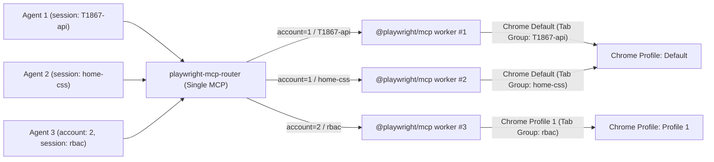

# playwright-mcp-router

> Session-isolated, multi-account MCP router for [`@playwright/mcp`](https://github.com/microsoft/playwright-mcp) — let multiple AI agents share your logged-in Chrome profiles concurrently **without hijacking each other's active tab**, with meaningful per-task Chrome tab group names.

[简体中文](./README.zh-CN.md)

---

## Why This Exists

When using `@playwright/mcp --extension` in multi-session AI IDEs / coding agents (Antigravity, Claude Code, Cursor, Codex, etc.):

1. Most MCP hosts spawn **one shared singleton MCP server process** across all concurrent conversations.
2. `@playwright/mcp` tools (`browser_navigate`, `browser_click`, `browser_snapshot`, `browser_network_requests`, ...) operate on a single `current` active tab pointer — so two concurrent agents inevitably hijack each other's active tab.
3. `--session-name` (the Chrome tab group label) is fixed at server startup, so you cannot dynamically name tab groups per task.
4. Switching across multiple Chrome accounts/profiles requires duplicating MCP servers (`playwright-1a`, `playwright-1b`, `playwright-2`, ...).

**`playwright-mcp-router`** solves all four problems with a zero-dependency Node.js proxy:



## Features

- **Zero Runtime Dependencies**: Pure Node.js (`>= 20`) ESM, instant startup.
- **True Process-Level Session Isolation**: Every `(account, session)` pair gets its own `@playwright/mcp` worker process and Chrome tab group — concurrent agents never steal focus or overwrite each other's active tab.
- **Dynamic Meaningful Tab Group Names**: Injects a required `session` parameter into all proxied Playwright tools so every agent creates a clearly labeled, color-coded Chrome tab group (e.g. `T1867-api-debug`, `checkout-css`).
- **Multi-Account Chrome Profile Routing**: Configure multiple Chrome profiles (`Default`, `Profile 1`, ...) and Playwright MCP Bridge tokens in one place, with a default primary account and on-demand switching via `account`.
- **Automatic Lifecycle & Cleanup**:
  - Coalesces concurrent in-flight startup calls for the same session.
  - Auto-evicts idle sessions after `idleTimeoutMs` (default 15 minutes), cleanly closing their Chrome tab groups.
  - Evicts the worker immediately when `browser_close` or `router_close_session` is called.
  - Enforces `maxSessions` cap and auto-recovers if a worker crashes.
- **Always Up-to-Date with Official `@playwright/mcp`**: Dynamically discovers and forwards the exact tool catalog from your installed `@playwright/mcp` binary (including `browser_network_requests`, `browser_network_request`, `browser_evaluate`, `browser_take_screenshot`, etc.).
- **Secret Safe**: Never exposes tokens in `router_list_sessions` or redacts accidental leaks from upstream error messages.

---

## Prerequisites

1. Node.js `>= 20`
2. Official [`@playwright/mcp`](https://github.com/microsoft/playwright-mcp) installed globally (recommended for fast startup):
   ```bash
   npm install -g @playwright/mcp@latest
   ```
3. (For reusing logged-in Chrome sessions) Install the **Playwright MCP Bridge** Chrome extension in each Chrome profile you want to automate, and copy each profile's `PLAYWRIGHT_MCP_EXTENSION_TOKEN`.

---

## Setup

### 1. Clone the repository

```bash
git clone https://github.com/huangzt/playwright-mcp-router.git
```

### 2. Create your private `accounts.json`

Store it outside the repository (default path `~/.config/playwright-mcp-router/accounts.json`, `chmod 600`):

```bash
mkdir -p ~/.config/playwright-mcp-router
cp accounts.example.json ~/.config/playwright-mcp-router/accounts.json
chmod 600 ~/.config/playwright-mcp-router/accounts.json
```

Example `~/.config/playwright-mcp-router/accounts.json`:

```json
{
  "defaultAccount": "1",
  "idleTimeoutMs": 900000,
  "maxSessions": 12,
  "playwrightArgs": [
    "--extension",
    "--background",
    "--caps=devtools"
  ],
  "accounts": {
    "1": {
      "label": "Work Account (Chrome Default)",
      "profileDirName": "Default",
      "token": "YOUR_ACCOUNT_1_EXTENSION_TOKEN",
      "colors": ["blue", "cyan", "purple"]
    },
    "2": {
      "label": "Secondary Account (Chrome Profile 1)",
      "profileDirName": "Profile 1",
      "token": "YOUR_ACCOUNT_2_EXTENSION_TOKEN",
      "colors": ["green", "orange", "yellow"]
    }
  }
}
```

> Tip: `token` also supports `${ENV_VAR}` interpolation if you prefer keeping tokens in environment variables.
> To find your exact Chrome `profileDirName` (`Default`, `Profile 1`, etc.), inspect `~/Library/Application Support/Google/Chrome/Local State` (macOS) or Chrome's `chrome://version` ("Profile Path").

### 3. Register in your MCP client (`mcp_config.json`)

```json
{
  "mcpServers": {
    "playwright": {
      "command": "/path/to/node",
      "args": [
        "/path/to/playwright-mcp-router/bin/playwright-mcp-router.js",
        "--config",
        "/Users/<you>/.config/playwright-mcp-router/accounts.json",
        "--playwright-bin",
        "/path/to/node_modules/@playwright/mcp/cli.js"
      ]
    }
  }
}
```

---

## Router Tools & Parameters

Every official `@playwright/mcp` tool is automatically augmented with:

| Parameter | Required | Description |
| :--- | :---: | :--- |
| `session` | **Yes** | Unique, descriptive task name (also shown as the Chrome tab group title, e.g. `T1867-api-debug`). |
| `account` | No | Account key from `accounts.json` (defaults to `defaultAccount`). |
| `color` | No | Optional Chrome tab group color override (`blue`, `red`, `yellow`, `green`, `pink`, `purple`, `cyan`, `orange`). |

Additional management tools provided by the router:

- `router_list_sessions` — List active isolated sessions (account, session name, color, PID, idle time) and configured accounts (without tokens).
- `router_close_session` — Gracefully close a specific `(account, session)` and remove its Chrome tab group.
- `router_close_all_sessions` — Gracefully close all active sessions.

---

## Testing

Run unit & mock concurrency tests (no browser required):

```bash
npm test
```

Run live concurrency test against your real Chrome profiles:

```bash
npm run test:live
```

---

## License

[MIT](./LICENSE)
