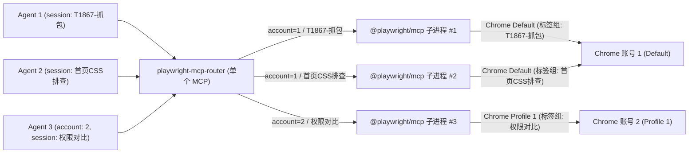

# playwright-mcp-router

> 面向 [`@playwright/mcp`](https://github.com/microsoft/playwright-mcp) 的**会话隔离 + 多账号**轻量 MCP 路由层：让多个 AI Agent 并发复用你已登录的 Chrome 账号与 Cookie，**彻底不抢焦点标签页**，并在 Chrome 中自动创建带任务名称的彩色标签组。

[English](./README.md)

---

## 解决什么痛点？

在 Antigravity、Claude Code、Cursor、Codex 等多会话 AI 工具中直接使用 `@playwright/mcp --extension` 时，常见 4 个痛点：

1. **多会话抢焦点**：客户端通常只托管一个全局单例 MCP 进程，所有并发 Agent 共用同一个 `current` 标签页指针，一方切页或导航就会把另一方的当前页切走。
2. **分组名写死**：`--session-name` 是进程启动参数，无法按任务动态命名 Chrome 标签组。
3. **多账号配置冗余**：要在多个 Chrome 账号（如 `Default` / `Profile 1`）之间切换或并发，必须重复配一堆 MCP 服务。
4. **遗留页面不清理**：调试结束不关页容易残留大量标签页与后台进程。

**`playwright-mcp-router`** 用零依赖 Node.js 代理层一次性解决：



## 核心特性

- **零第三方运行时依赖**：纯 Node.js（`>= 20`）ESM 实现，毫秒级启动。
- **真正进程级并发隔离**：每个 `(account, session)` 独占一个 `@playwright/mcp` 子进程与标签组，任意多 Agent 并发同账号调试也互不抢焦点，且 100% 共享登录态和 Cookie。
- **强制有意义的分组标签名**：自动向所有 Playwright 工具注入必填 `session` 参数，Chrome 中直接显示对应任务名的彩色标签组。
- **多 Chrome 账号路由**：单份配置管理主账号 + 备用账号，默认走主账号，需要双账号权限对比时通过 `account: "2"` 一键切换。
- **自动生命周期管理**：
  - 同 `(account, session)` 并发启动自动合并，不重复拉起进程；
  - `browser_close` / `router_close_session` 自动回收子进程与标签组；
  - 空闲超时自动清理（默认 15 分钟），支持 `maxSessions` 上限保护与崩溃自动恢复。
- **紧跟官方更新**：动态透传本机安装的官方 `@playwright/mcp` 全部工具（模拟操作、截图、Console、`browser_network_requests` / `browser_network_request` 抓完整请求响应体、`browser_evaluate` 查 CSS 等）。
- **凭证安全**：Token 仅保存在用户私有配置或环境变量中，查询接口与错误日志自动脱敏。

---

## 快速开始

### 1. 前置依赖

- Node.js `>= 20`
- 全局安装官方 `@playwright/mcp`：
  ```bash
  npm install -g @playwright/mcp@latest
  ```
- 在需要复用的 Chrome 账号中安装官方扩展 **Playwright MCP Bridge**，并复制各自的 `PLAYWRIGHT_MCP_EXTENSION_TOKEN`。

### 2. 创建私有账号配置文件

建议放在仓库目录外（默认读取 `~/.config/playwright-mcp-router/accounts.json`）：

```bash
mkdir -p ~/.config/playwright-mcp-router
cp accounts.example.json ~/.config/playwright-mcp-router/accounts.json
chmod 600 ~/.config/playwright-mcp-router/accounts.json
```

示例内容：

```json
{
  "defaultAccount": "1",
  "idleTimeoutMs": 900000,
  "maxSessions": 12,
  "playwrightArgs": [
    "--extension",
    "--background",
    "--caps=devtools"
  ],
  "accounts": {
    "1": {
      "label": "工作账号 (Chrome Default)",
      "profileDirName": "Default",
      "token": "你的账号1_EXTENSION_TOKEN",
      "colors": ["blue", "cyan", "purple"]
    },
    "2": {
      "label": "备用账号 (Chrome Profile 1)",
      "profileDirName": "Profile 1",
      "token": "你的账号2_EXTENSION_TOKEN",
      "colors": ["green", "orange", "yellow"]
    }
  }
}
```

> `token` 字段也支持 `${ENV_VAR}` 环境变量占位符。

### 3. 配置到 MCP 客户端（`mcp_config.json`）

```json
{
  "mcpServers": {
    "playwright": {
      "command": "/path/to/node",
      "args": [
        "/path/to/playwright-mcp-router/bin/playwright-mcp-router.js",
        "--config",
        "/Users/<你>/.config/playwright-mcp-router/accounts.json",
        "--playwright-bin",
        "/path/to/node_modules/@playwright/mcp/cli.js"
      ]
    }
  }
}
```

---

## 注入参数与管理工具

所有官方 `browser_*` 工具都会自动附加以下路由参数（转发给底层前会自动剥离）：

| 参数 | 是否必填 | 说明 |
| :--- | :---: | :--- |
| `session` | **必填** | 当前任务的独立会话名（同时作为 Chrome 标签组名称，如 `T1867-接口抓包`）。 |
| `account` | 可选 | 目标 Chrome 账号键名（默认使用 `defaultAccount`，例如 `"1"`，备用 `"2"`）。 |
| `color` | 可选 | 覆盖新建会话的标签组颜色（`blue` / `cyan` / `purple` / `green` / `orange` / `yellow` / `pink` / `red`）。 |

额外内置 3 个管理工具：
- `router_list_sessions`：查看当前活跃会话与已配置账号（不含 Token）。
- `router_close_session`：关闭指定 `(account, session)` 的标签组并退出子进程。
- `router_close_all_sessions`：关闭所有活跃会话。

---

## 测试

运行单元测试与并发隔离测试（不依赖真实浏览器）：

```bash
npm test
```

运行真实 Chrome 多账号并发端到端测试：

```bash
npm run test:live
```

---

## License

[MIT](./LICENSE)
